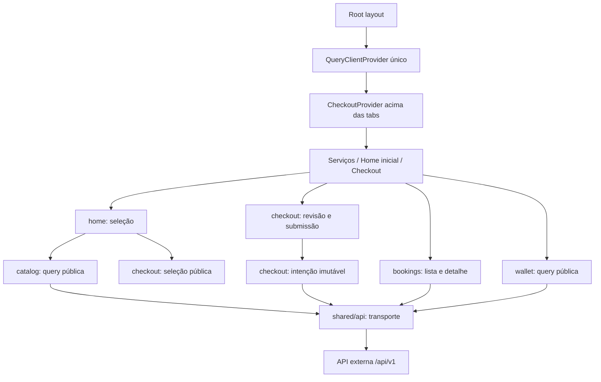

# Cicclo mobile: design executável

**Status:** Approved (pré-aprovado expressamente pelo usuário nesta conversa em 2026-10-21).
**Spec:** [spec.md](spec.md). **Tarefas:** [tasks.md](tasks.md).
**Limite da autorização atual:** detalhar documentos. Não iniciar implementação, branches, commits ou operações remotas nesta sessão. Não abrir Plannotator.

## Architecture Overview

Adotamos features de domínio, funções concretas e composição. Estado remoto pertence ao QueryClient; seleção e intenção pertencem ao checkout; apresentação e navegação não implementam regras financeiras.

Alternativas consideradas dentro do mesmo escopo:

| Abordagem | Trade-off | Decisão |
| --- | --- | --- |
| Features + módulos funcionais pequenos | Fronteiras públicas explícitas, sem abstração por reflexo | Escolhida, conforme spec aprovada e AD-001 |
| Pastas técnicas globais de screens/hooks/services | Menor organização inicial, mas dispersa cada regra financeira entre pastas | Rejeitada: não grita domínio |
| Ports/usecases/repositories por feature | Mais indireção e contratos para manter sem múltiplas implementações reais | Rejeitada: complexidade sem necessidade atual |



O diagrama representa dependências, não uma segunda camada de classes. Não gerar pastas vazias. Não criar factories, repos genéricos, command bus, interfaces de cada função ou feature `machines` sem tela real.

## Code Reuse Analysis

Base observada: `feat/bootstrap-monorepo`, commit `9788d0b`, no outro worktree. Reconfirmar em T1; não copiar mudanças locais.

| Existente | Localização na base | Uso |
| --- | --- | --- |
| Expo/RN/React/TS | `apps/mobile/package.json:15–31` | Preservar versões e lock; não fazer scaffold |
| Jest-expo 58 / Jest 30 / RNTL 14 | `apps/mobile/package.json:20–35` | Reaproveitar preset e estilo async de testes |
| Strict e ESLint Expo | `apps/mobile/tsconfig.json:1–8`, `eslint.config.js:1–7` | Preservar; alias só se funcionar em TS, Metro e Jest |
| Scripts mobile | `apps/mobile/package.json:6–13` | Usar gates reais, sem criar outro runner |
| Teste de smoke | `apps/mobile/__tests__/App.test.tsx:5–16` | Migrar contrato de tela estática para navegação; substituição expressamente aprovada na spec |
| Testes de bootstrap | `tests/bootstrap.test.mjs:18–45` | Manter lockfile único, versões exatas e strict |
| README raiz | `README.md:23–82` | Preservar onboarding backend e acrescentar link mobile |

Não existe cliente HTTP, Router, feature, tema ou provider de negócio para reutilizar. O único teste mobile disponível foi amostrado integralmente; não há cinco testes mobile existentes a amostrar.

## Módulos e contratos públicos

Todos os caminhos abaixo são relativos a `apps/mobile/src`. Arquivos surgem junto ao primeiro consumidor. Os nomes das funções são contratos **internos propostos**, não APIs de bibliotecas nem DTOs externos já verificados.

| Módulo | Responsabilidade / contrato público | Dependências / reuso |
| --- | --- | --- |
| `shared/config/env.ts` | Ler/validar origem HTTP(S) e displayName; erro de configuração tratável; nome vazio vira Visitante | Acesso estático a `process.env.EXPO_PUBLIC_*`, URL; sem segredo ou fallback localhost |
| `shared/api/apiError.ts` | `ApiError`, parse de ProblemDetails e Retry-After; entrada desconhecida | Zod somente na fronteira; errorCode/status, nunca detail para lógica |
| `shared/api/client.ts` | `requestJson(options): Promise<unknown>`; uma origem/prefixo, timeout, signal, headers, parsing | fetch nativo; normalizador; sem importar features |
| `shared/api/queryClient.ts` | Construir um QueryClient estável e política comum GET | TanStack Query; inicialização junto ao primeiro GET |
| `shared/layout/AppHeader.tsx` | Receber `displayName`, estado de saldo, valor confirmado, label de desatualização e onRetry; só apresentação | Tokens semânticos e formatBRL; não importa wallet |
| `shared/lib/money.ts` | `formatBRL(cents)`; exige inteiro seguro; aritmética de checkout não mora aqui | Intl, sem rede |
| `features/wallet/queries.ts` | Schema wallet, fetch com signal, `walletKey`, `walletOptions()` e tipos públicos de leitura | shared/api; schema ajustado ao contrato real |
| `features/catalog/queries.ts` | Schema catálogo, fetch, `catalogKey`, `catalogOptions()` e tipo público de serviço | shared/api; sem preços fixos |
| `features/catalog/components/ServiceCard.tsx` | Nome/preço/disponibilidade; recebe quantidade e callbacks quando seleção existir | Props pequenas; sem HTTP/Context |
| `features/home/HomeScreen.tsx` | Coordenar consulta e seleção pública; loading/empty/error; compor cards | APIs públicas de catalog e checkout; sem calcular total no JSX |
| `features/checkout/checkoutReducer.ts` | Transformar quantidades/preferência; nenhuma operação externa | Tipos locais e ações discriminadas |
| `features/checkout/checkoutSelectors.ts` | `deriveSelection(state, catalog, wallet)`; valida limites/preço/saldo e expande serviceCodes | Funções puras; entradas readonly; um cálculo de total |
| `features/checkout/CheckoutProvider.tsx` | Seleção e comandos públicos; acima das tabs, um por app | Reducer; queries públicas wallet/catalog; coordenador de submissão a partir de E3 |
| `features/checkout/CheckoutScreen.tsx` | Revisão, consentimento, estados de envio/sucesso/recuperação | Context público, sem fetch nem UUID no render |
| `features/checkout/createBooking.ts` | Contrato do único endpoint POST de compra; valida payload/response, sem regra de UI | shared/api; tipos gerados ou temporários documentados |
| `features/checkout/useBookingSubmission.ts` | Controlar intenção única, guarda síncrona, envio e verificação explícita | createBooking, randomUUID, Query mutation; sem carteira própria |
| `features/checkout/applyConfirmedBooking.ts` | Aplicar confirmação ao cache de leitura existente e invalidar keys pertinentes | QueryClient e contratos públicos de wallet/bookings; sem navegar |
| `features/bookings/status.ts` | Status conhecidos, classificação e elegibilidade de ações | Funções/lookup únicos, sem efeitos |
| `features/bookings/listQuery.ts` | Contrato de GET listagem, paginação real e key prefix da feature | shared/api; não reutilizar response de POST |
| `features/bookings/detailQuery.ts` | Contrato de GET detalhe, UUID validado e query por bookingId | shared/api; schema próprio |
| `features/bookings/BookingsScreen.tsx` | FlatList, filtros locais e ofertas visíveis em P1 | listQuery/status, rota de detalhe |
| `features/bookings/BookingDetailsScreen.tsx` | Compor leitura e comandos habilitados por capacidade real | detailQuery/status; catálogo não substitui preço histórico |
| `shared/hooks/useMobileLifecycle.ts` | AppState + expo-network, limpeza, foco/online e sinal de revalidação | Sem importar features; instalado uma vez no CheckoutProvider em E4 |
| `features/bookings/activateItem.ts` | Um comando REST activate com mutation options | HTTP, status e invalidação; só P1 |
| `features/bookings/confirmItem.ts` | Um comando REST confirm com mutation options | Mesma política de erro, sem retry automático; só P1 |
| `features/bookings/cancelItem.ts` | Um comando REST cancel com feedback confirmado | Sem crédito otimista; só P1 |
| `features/bookings/reportIssue.ts` | Um comando REST report-issue, aceita 202 conforme contrato | Sem inferir refund; só P1 |
| `features/bookings/components/OfferCountdown.tsx` | Renderizar restante a partir de expiresAt, onExpired uma vez por oferta | Date.now e timer limpo; sem transição de status |
| `features/bookings/useBookingPolling.ts` | Política de polling por visibilidade/online/active/terminal | Query, status e lifecycle; só P1 |

Endpoints pequenos mantêm schema, função de rede e query/mutation options coesos no mesmo módulo. Não separar em três arquivos pass-through só para reproduzir o handoff. Extrair schema compartilhado apenas quando há mais de um consumidor real.

### Importações e composição

- Módulos explicitamente públicos: `wallet/queries`, `catalog/queries`, `checkout/CheckoutProvider`, `bookings/listQuery`, `bookings/detailQuery`, `bookings/status`. Não é obrigatório criar index.ts para cada pasta.
- `app` importa screens/APIs públicas e o header shared. `shared` nunca importa features. Nenhuma feature importa rotas.
- Home consome seleção pública; checkout consome queries públicas de wallet/catalog e keys públicas de bookings para invalidação. Bookings não importa checkout.
- QueryClientProvider e CheckoutProvider ficam no root. Abas montadas preservam seleção/intenção; sair do detalhe não as recria.
- `app/(tabs)/_layout.tsx` define ordem visual services/index/checkout, Home inicial e conecta props do header/badge. `app/bookings/[id].tsx` só valida/encaminha parâmetro e compõe detalhe.
- O refactor do entrypoint é uma unidade de migração: manifest/config/root/rotas finas/teste mudam juntos para não deixar commit não executável. Não aproveitar para reformatar o monorepo.

## Data Models e autoridade

### Seleção local

```typescript
type CheckoutSelection = {
  quantities: Readonly<Record<string, number>>;
  preferredFirstServiceCode: string | null;
};
```

Não contém wallet, catálogo completo ou bookings. Contagens são inteiras não negativas; remover última unidade exclui chave e preferência correspondente. Limite total 10 é checado no selector/ação pública e antes do POST. Zero é apenas seleção vazia, nunca comando válido. Repetições são expandidas, não deduplicadas.

`deriveSelection` retorna total, quantidade, disponível/estimado e lista de problemas. Todo cálculo usa inteiros seguros. Com saldo 5000 e preços 1890/2090, resultado é 3980/1020; duas lavagens são 3780. Header permanece 5000. Estado derivado não é persistido no Context.

### Revisão e consentimento

A revisão registra somente a fotografia local consentida: códigos/quantidades, preços relevantes e total. Comparar essa fotografia com catálogo validado atual. Mudança exige revisão; não inferir consentimento só porque houve refetch. Remover um código inválido continua permitido. O CTA de confirmar representa a revisão explícita do total exibido.

Enquanto existe uma intenção indeterminada, ela é imutável e prevalece sobre alterações da seleção. Preferir bloquear edição financeira até resolver para evitar ambiguidade; navegação e leitura continuam permitidas.

### Intenção e submissão

```typescript
type BookingIntent = {
  key: string;
  payload: Readonly<{
    serviceCodes: readonly string[];
    preferredFirstServiceCode?: string | null;
    expectedTotalCents: number;
  }>;
  createdAt: string;
};
type SubmissionStatus =
  | 'idle' | 'submitting' | 'confirmed' | 'rejected' | 'unknown';
```

Esta forma é interna; serialização exata segue contrato real. Congelar/copiar array e body no instante da confirmação. Guardar chave, body serializado e data de criação da intenção; reenvio usa esse body original, sem recálculo/reordenação. `randomUUID` vem de expo-crypto, nunca do render.

- Reserva síncrona via ref/guarda antes de await impede dois toques no mesmo tick. A guarda de submissão é independente do estado visual de React.
- `rejected` exige código/status cuja documentação garanta ausência de aceitação financeira. Erro local comprovadamente antes de fetch não é compra desconhecida.
- Após envio, network/timeout/5xx/2xx inválido/4xx não classificado produzem unknown. `IDEMPOTENCY_CONFLICT` bloqueia resolução automática, sem liberar nova chave.
- PRICE_CHANGED libera apenas caminho de revisão. Nova confirmação gera nova intenção; retry da intenção antiga não troca total.
- 429 respeita Retry-After; se o contrato garantir recusa, é rejeitado recuperável. Sem garantia financeira, conservar intenção em unknown. Não confundir espera de rate limit com autorização de nova compra.
- `verify()` requer ação explícita, ausência de envio concorrente, retenção válida e mesmo key/body. Sem TTL conhecido, integração financeira fica bloqueada. Não inferir TTL de cache da biblioteca.
- P0 não persiste essa intenção entre encerramentos do processo. P2a implementa isso se ativado; não esconder a limitação.

### Tipos externos e capacidades

OpenAPI real é a fonte externa. Guardar snapshot/hash/commit em `apps/mobile/docs/api-contract.md` e, quando fornecido, snapshot do documento em `docs/openapi-v1.json`; gerar somente os tipos consumidos pelo frontend em `shared/api/generated/openapi.d.ts`. Nunca editar gerado manualmente.

Sem OpenAPI, manter tipos temporários mínimos no módulo consumidor, derivados de Zod, e marcar a limitação no registro contratual. Isso habilita testes isolados, não prova integração. Gerar tipos e adaptar schema quando o documento chegar é parte do primeiro consumo real, não um segundo sistema de tipos permanente.

No primeiro consumidor com OpenAPI disponível, instalar `openapi-typescript` como dev dependency exata e gerar a partir do snapshot efetivo. Comando planejado, a executar da raiz integrada somente depois de existirem pacote/documento:

```sh
pnpm --filter @cicclo/mobile exec openapi-typescript ./docs/openapi-v1.json -o ./src/shared/api/generated/openapi.d.ts
```

Não adicionar script apontando para URL presumida. Comparar tipos gerados e schemas de runtime na mesma tarefa do endpoint; geração sem drift precisa ser reproduzível.

Capacidades P1 são um pequeno objeto de configuração comprovada, junto ao registro contratual. Não existe feature flag service nem detecção por POST/404. Cada comando tem suporte próprio; cancel não é habilitado porque activate existe. Refund depende de campo/resposta efetivos, não só de badge.

## Transporte, cache e lifecycle

### HTTP e políticas iniciais

- Origem explícita HTTP(S), sem path/query/hash; `/api/v1` acrescentado uma vez. `.env.example` documenta host/porta sem credenciais; configuração inválida mostra erro acionável.
- Fetch central envia Accept, Content-Type em JSON e Idempotency-Key fornecida pelo chamador financeiro. Nunca gera chave dentro do transporte.
- Timeout inicial de 15 s por request, com cleanup e propagação do AbortSignal. É limite de espera do cliente, não timeout da transação servidor.
- GET: no máximo 1 retry em falha transitória, atraso inicial 1 s, sem retry em 4xx definitivo/erro de contrato; 429 só após prazo informado, sem loop. Todos os casos testados com relógio controlado.
- Mutation financeira: `retry: false` e execução sem pausa implícita (`networkMode: 'always'` na versão compatível do Query, com validação local antes do envio). Isso **não** autoriza enviar offline: evita enfileirar e retomar comandos silenciosamente. Rede ausente conhecida bloqueia antes de fetch; perda durante envio gera unknown.
- Não usar persistência/dehydration de mutations nem `resumePausedMutations` para finanças. Sem scope/fila serial de mutations que possa reaplicar comando depois de reconectar.
- Client devolve unknown em sucesso; módulo de endpoint aplica Zod. A classificação financeira é do checkout, não de um wrapper HTTP genérico.
- Log somente kind/status/errorCode/traceId sanitizados. Sem body de compra, chave de intenção ou mensagem interna do servidor em logs de produção.

### Query keys e atualização

| Dono | Key | Política inicial |
| --- | --- | --- |
| wallet | `['wallet']` | staleTime 10 s; sem polling; refetch em eventos relevantes |
| catalog | `['services']` | staleTime 60 s; refetch em entrada/refresh/conflito |
| bookings list | `['bookings', 'list', parâmetros reais]` | staleTime 10 s; filtros locais sobre dados carregados |
| booking detail | `['bookings', 'detail', id]` | staleTime 5 s; UUID inválido não consulta |

Definições são exportadas pelo módulo dono; não copiar arrays de strings em screens. Endpoint de listagem paginado usa parâmetros reais e informa alcance da página; não anunciar coleção completa sem tê-la carregado.

Fluxo de confirmação:

1. Receber 201/200 válido e validar forma/invariantes; confirmar resultado da intenção antes de efeitos secundários.
2. Aguardar cancelamento das queries wallet em voo, com signal consumido pelo fetch; cancelQueries pode reverter cache, por isso ocorre **antes** de setQueryData.
3. Atualizar somente cache existente de wallet compatível com remainingBalanceCents. Não inventar updatedAt ou outro campo. Ausência de wallet completa: exibir confirmação pelo resultado da compra e refetch; header não fabrica DTO.
4. Invalidar wallet e prefixo público de bookings; preencher detalhe apenas se response realmente for compatível com schema de detalhe. Não usar schema POST como GET.
5. Limpar seleção e oferecer acompanhamento; E3 pode manter resumo confirmado local até E4. Falha do refetch/navegação não transforma compra confirmada em rejeitada nem reenvia POST.
6. Testar GET antigo diferido, inclusive transporte que resolve depois do cancelamento. Política de cache eventual do servidor precisa ser conhecida: sem versão/consistência, não prometer que comparar saldos resolve ordenação. Gate E3 registra limitação ou bloqueia integração.

### Reconexão, background e freshness

E4 instala um único listener AppState e um único monitor expo-network. `undefined` inicial de rede não é false confirmado nem autorização financeira. Expor prontidão do checkout como estado operacional, não saldo duplicado.

O hook shared apenas observa lifecycle e integra focusManager/onlineManager. O provider checkout usa suas queries públicas para invalidar/revalidar carteira e catálogo ao retornar/reconectar. Até ambas terminarem com sucesso nessa revalidação, adição e compra ficam bloqueadas. Header com dado retido usa rótulo de última atualização; erro de refetch não se disfarça de saldo atual.

Não criar uma segunda Context global para dados financeiros. Revalidação é um sinal/epoch de sessão no provider, não banco local. GETs podem recuperar automaticamente; POST só parte de confirmação/verificação explícita. Teste de reconexão deve afirmar zero POST sem interação.

### P1: tempo, comandos e polling

- Status/ações têm uma política única em bookings/status. Activate só pending_activation; confirm só oferta não vencida visualmente; cancel só pending_activation/queued/to_be_confirmed; report conforme contrato real, nunca refund presumido.
- Countdown é `max(0, ceil((Date.parse(expiresAt)-Date.now())/1000))`. Recalcular no foreground; interval serve somente a render. onExpired invalida uma vez por expiresAt/item, não uma vez a cada render no zero.
- 409/410 encerra estado pending local e refaz GET; UI não muda queued/in_progress por conta própria. 202 report mostra relato recebido, sem modificar wallet.
- Polling inicial: lista visível 10 s com booking não terminal; detalhe visível 5 s não terminal. App ativo e online são necessários. Terminal, blur, background e offline retornam false. Não dar polling a wallet/catalog por reflexo.
- Intervalos são defaults revisáveis à luz do rate limit real. Testar que os observers param, não apenas que o número retorna false. Lista destaca oferta sem anunciar cada segundo ao leitor de tela.

## UI, acessibilidade e native

Tema único com cores semânticas, espaçamento e tipografia mínimos surge com o primeiro header/card. AppHeader recebe props; componentes visuais não leem API. Sem extrações para shared por reutilização hipotética.

Ações devem ter texto/role/label, disabled/busy corretos e feedback persistente/consultável. Seleção insuficiente não depende de clicar num botão disabled. Sucesso financeiro, fila paga, relato e estorno têm vocabulário distinto.

Root/navigator e header definem um responsável por cada inset. Verificar Android com gestos, viewport pequeno e fonte 200%; permitir quebra/scroll, sem ocultar saldo ou CTA. Não exigir snapshots visuais ou E2E. Registros de execução incluem dispositivo/emulador, versão, URL de API não secreta e passo/resultado.

## Error Handling Strategy

| Falha | Recuperação | O que não fazer |
| --- | --- | --- |
| URL ausente/inválida | Tela de configuração e instrução de variável pública | Usar localhost silenciosamente |
| Wallet/catalog GET inválido | Erro recuperável, bloquear nova seleção/compra | Fallback zero/5000 ou fixture |
| Insuficiência/serviço indisponível comprovados | Refetch pertinente e seleção revisada | Mostrar débito sem confirmação |
| PRICE_CHANGED | Revisão explícita; nova intenção após consentimento | Trocar preço e reenviar automaticamente |
| Timeout/5xx/parse após compra | Unknown, mesma intenção, CTA de verificar | Declarar falha financeira ou gerar UUID novo |
| Retry-After | Espera até deadline, um acionamento por usuário | Loop de POST ou fila offline |
| Erro em GET depois de sucesso | Compra segue confirmada; leitura sinaliza indisponibilidade | Reexecutar compra para "corrigir" cache |
| Listagem/detalhe ausentes | Estado honesto de indisponibilidade e P0 bloqueado | Histórico local fake |
| Oferta expira/409/410 | Refetch e feedback do estado real | Estender 60s ou atribuir máquina localmente |

## Tech Decisions e limites de pré-aprovação

- Pré-aprovação cobre este design, a matriz de testes e tarefas em `tasks.md`, sem nova rodada Plannotator.
- P0 é obrigatório. Design/tarefas de P1 estão pré-aprovados **condicionalmente** a API suportar e P0 passar; pré-aprovação não simula endpoints.
- P2 mantém decisão explícita de ativação separada, conforme spec. Procedimentos estão descritos abaixo para não haver trabalho oculto, mas não integram Execute padrão.
- Ferramentas propostas por tarefa: read/grep/glob/patch/shell; Context7 para APIs de biblioteca; skills tlc-spec-driven e coding-guidelines durante código; well-commited para commits se aplicável, sem push. Não utilizar Jira/Workforce/Atlassian para implementar o mobile. A pré-aprovação do planejamento não autoriza subagentes de implementação; oferecer lotes antes de Execute conforme skill.
- Não há biblioteca específica de design system, form ou HTTP a adicionar. Resolver versões nativas com Expo e manter pinagem exata verificada pelo bootstrap.

## P2: procedimento de ativação, não tarefa implícita

| Opcional / branch própria | Design preparado | Gate antes de habilitar |
| --- | --- | --- |
| Intenção persistida / `feat/mobile-07-pending-intent-recovery` | Um módulo storage só de intenção; escrita antes de primeiro fetch; versionar schema do registro; validação de restore; erro de escrita impede envio, corrupção bloqueia restauração automática; cleanup falho não deve permitir duplicação | Decisão de ativar P2a; TTL conhecido; testes de reinício após commit servidor/antes de cleanup, chave/body idênticos, zero saldo persistido, storage rejeitado/corrompido |
| SignalR / `feat/mobile-08-realtime-invalidation` | Um hook de conexão para eventos comprovados, invalida keys e faz cleanup; REST sempre suficiente | Hub/eventos reais publicados, P0/P1 estáveis, decisão de ativação; evento perdido/reconnect convergem por GET sem compra extra |
| APK / `chore/mobile-09-android-artifact` | Usar configuração de build viável já existente; documentar artefato e checksum se produzido, API alcançável pelo aparelho | Decisão de ativação, ferramenta/conta/configuração descobertas e autorização para build externo se necessário; instalação e smoke real. Não inventar comando EAS sem configuração |

Ao ativar um opcional, derivar ACs/IDs e tarefas atômicas específicas antes de codificar; manter garantia financeira, nova branch e Verifier. Não instalar todos os opcionais ao preparar P0.

## Risks & Concerns

| Evidência / localização | Risco | Mitigação / tarefa |
| --- | --- | --- |
| Worktree atual em 84eaf98; bootstrap em 9788d0b | Criar app duplicado e perder histórico | T1, integração local por ancestralidade; preservar outro worktree |
| Outro worktree tinha `.gitignore` modificado | Capturar trabalho do usuário | T1 status e staging explícito; nunca copiar árvore local |
| `apps/api/src/Program.cs:1–8` | Não existem contratos de negócio na base inspecionada | Gates C1/C2/C3/P1 de tasks; sem backend no escopo |
| `apps/mobile/__tests__/App.test.tsx:5–16` | Smoke antigo contradiz leitura API | T5 migra requisito expressamente aprovado, sem simplesmente excluir teste |
| `tests/bootstrap.test.mjs:38–45` | Dependência com range viola baseline | Cada consumidor inclui instalação compatível/pinagem/lock em seu commit |
| `spec.md`, BUY-08/09 e SAFE-04 | Mutation offline pode retomar sem gesto mesmo com retry false | T18/T19/T27: networkMode sem pausa + preflight + zero POST em reconnect |
| `spec.md`, BUY-05 | GET obsoleto derruba saldo confirmado | T20: cancel antes do set; teste diferido e gate de consistência real |
| Handoffs divergentes em errorCode | Negócio interpretado por nome errado | C2; allowlist real, demais casos conservadores |
| Schema list/detail não fechado | Assumir retorno POST universal | T23/T25, snapshot e schema separados |
| P0 sem storage da intenção | Reinício perde chave | README T30; P2a opcional explícito, sem promessa de recovery entre processos |
| Sem Android executado | Aprovar apenas bundle | T29/T30 e gate N1, sem PASS por inferência |

## Fontes e validação deste design

Codebase e documentos da base foram relidos nesta etapa; não houve mudança de HEAD observada. Confirmed lessons: nenhuma.

Context7 consultado após codebase/docs: TanStack Query (`/tanstack/query`) sobre networkMode/retry/pausa e cancelQueries; Expo (`/expo/expo`) sobre expo-network, cleanup/estado inicial e expo-crypto randomUUID. As consultas reforçam os contratos internos acima; instalação deve conferir versão exata resolvida pelo SDK 58.

Referências oficiais: [Query React Native](https://tanstack.com/query/latest/docs/framework/react/react-native), [Query network mode](https://tanstack.com/query/latest/docs/framework/react/guides/network-mode), [Query cancellation](https://tanstack.com/query/latest/docs/framework/react/guides/query-cancellation), [Expo Network](https://docs.expo.dev/versions/latest/sdk/network/), [Expo Crypto](https://docs.expo.dev/versions/latest/sdk/crypto/), [Expo Router instalação](https://docs.expo.dev/router/installation/).

Este design está aprovado documentalmente. Não é prova de implementação, compatibilidade instalada ou endpoint disponível.
